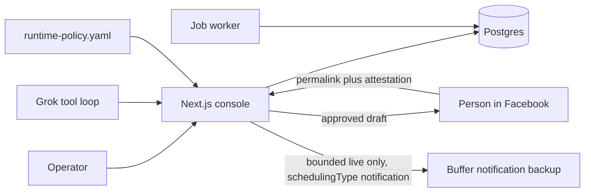

# SMACKIN’ VIP community ops

Operating console for the private group [SMACKIN’ VIP](https://www.facebook.com/groups/604690051505802/). It keeps the work queue, the fact library, the weekly rhythm, and the publication record. Grok can draft through tools this app executes. A person posts to Facebook.

Default mode is **draft**. Publication can be paused from Settings.

## Architecture



The assistant’s name is “SMACKIN’ community assistant.” It does not speak as Cole. Founder slots are drafts Cole rewrites and posts himself.

Facts, reply caps, the five-post week, follow-up states, and the advent-calendar tease window live in `policy/runtime-policy.yaml`. The gate reads that file. A prompt cannot widen it.

Jobs are rows in Postgres (`FOR UPDATE SKIP LOCKED`): capability probe, overdue follow-up scan, and metric rollup. They do not post.

### Publication states

`awaiting_human` and `buffer_notification_scheduled` are not published. `verified` requires a `/groups/604690051505802/posts/{id}` link and two human checks. Anything else that comes back with a link is `unverified`. There is no status named published.

## Facebook capabilities

Proven against Meta’s Groups API removal (April 22, 2024) and a read-only Buffer check on November 3, 2026. Detail is in [docs/capability-report.md](docs/capability-report.md). The same registry is on the capability screen.

| Path | Status |
| --- | --- |
| Graph read, publish, comment, member list | Unsupported. Not implemented. |
| Unattended browser or scraped session | Unsupported. The Facebook password is not stored. |
| Person posts the approved draft, then pastes the link | Supported as a human procedure. This is the primary path. |
| Buffer group channel `6aea4900e29c69a17150b894` | Connected, degraded: the stored group URL repeats `https://`. |
| Buffer `schedulingType=notification` | Backup only, needs `BUFFER_API_KEY`, bounded live, after approval. A Buffer id is not a verified post. |
| Buffer automatic group publish | Unsupported, and rejected in code. |
| Drive folder sync from this app | Needs setup. The folder was readable in the setup session only. |
| Grok tool calling | Implemented. Live calls need `XAI_API_KEY`. Approve and publish are not tools. |
| Live contribution ingest | Not available. Enter rows by hand. Sample rows are labeled and kept out of the official metric. |

## Run locally

Node 22.

```bash
cp .env.example .env.local
npm install
npm run setup
npm run dev
```

Open http://localhost:3000. With `DATABASE_URL` unset, data lives in embedded Postgres at `.data/pglite` (one process). Set `DATABASE_URL` before running `npm run worker` next to the web app.

```bash
npm test          # 16 acceptance tests plus job and Grok tool-loop tests
npm run demo      # verified fixture path
npm run demo unverified
npm run typecheck
```

Tests do not call Facebook, Buffer, or Grok. The Grok test uses a fake HTTP response and checks that the API key is not stored in the trace.

## Screens

Today, Review, Calendar, Follow-ups, Member contributions, Learning, Knowledge, Settings. The capability registry and the demo path are linked from Today and Settings.

Settings changes mode (`observe`, `draft`, `bounded live`) and pauses publication.

## What Cole supplies to go live

See [docs/startup-checklist.md](docs/startup-checklist.md) and [docs/deploy-recovery.md](docs/deploy-recovery.md).

- `XAI_API_KEY` if Grok should draft
- `BUFFER_API_KEY` if the notification backup should send, plus the Buffer mobile app and a corrected channel URL
- `OPS_ACCESS_TOKEN` and `DATABASE_URL` on any shared host
- His own Facebook session for the actual post. Login email for that vault entry is coleschefer55@yahoo.com. The password is not a setting.
- A real Wednesday note, or a skipped Wednesday
- Replacements for every `[CONFIRM]`
- Staff names confirmed when contributions are typed in: Cole Schaefer, Brian Waddick, Marc, Eli

Support mail is contact@smackinsnacks.com. For the week of November 2, 2026 the only offer language on file is an advent-calendar tease with no date, price, or access.

The two-week draft calendar is in [docs/sample-calendar.md](docs/sample-calendar.md).
